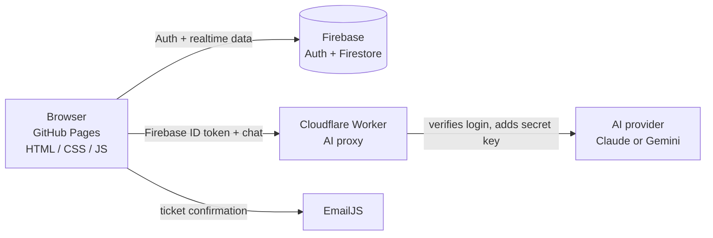
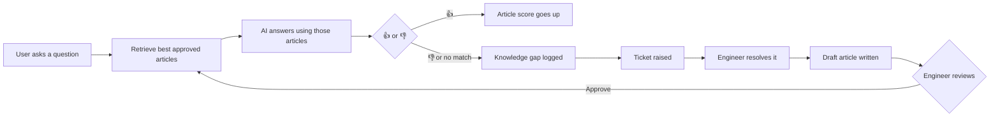

# 🛡️ Kelvinet Smart IT Helpdesk

An AI-powered IT support chatbot and ticketing system built with **vanilla HTML, CSS and JavaScript**, **Firebase** (Auth + Firestore) and a **Cloudflare Worker** that keeps the AI key off the browser. Users describe a problem in chat, get step-by-step help instantly, and escalate to a ticket when the bot can't fix it. Engineers and admins manage everything from a live dashboard.

Built by [Kelvinet Technologies](https://github.com/) — Maua, Meru, Kenya.

> **Live demo:** `https://YOUR-USERNAME.github.io/YOUR-REPO/`

---

## ✨ Features

**For users**
- 💬 AI support chat grounded in the company Knowledge Base, with numbered steps and a "Based on" source line
- 👍👎 Rate every answer; your feedback improves the knowledge base
- 🎫 One-click ticket creation — the AI pre-fills the title, description, category and priority from your conversation
- 🖼️ Attach screenshots in chat and files to tickets
- 🖥️ Optional remote-support request: share your **RustDesk** or **AnyDesk** session ID on a ticket
- 📧 Email confirmation for every ticket (EmailJS)
- 💡 Proactive tips based on the day, time and season
- 🌓 Light / dark mode

**For engineers and admins**
- 📊 Live dashboard: KPIs, tickets by category and priority, resolution rate, activity feed, prioritised action queue
- 🎟️ All tickets in real time, with search, filters, status workflow (Open → In Progress → Waiting → Resolved), notes and CSV export
- 📚 Knowledge Base builder (add, edit, delete, search)
- ✅ **Resolve Ticket** workflow: engineers record the root cause and the fix, and the user sees how it was resolved
- ⚡ Resolved tickets become **draft** KB articles (AI-written, redacted, reviewed by a human before the bot uses them)
- 🧠 **Learning loop** dashboard: unanswered questions, article quality, helpful rate
- 📚 25 professionally written starter articles in one consistent format, loaded with one click
- 👥 Admin-only user management and role changes
- 🏷️ Sequential ticket IDs: `T_KT001`, `T_KT002`, …

**Resilience**
- If the AI is unreachable the chatbot falls back to an offline keyword bot that searches the Knowledge Base, so users are never left without a reply.

---

## 👥 Roles & permissions

| Capability | User | Engineer | Admin |
|---|:--:|:--:|:--:|
| Chat with the AI assistant | ✅ | ✅ | ✅ |
| Create tickets | ✅ | ✅ | ✅ |
| View own tickets | ✅ | ✅ | ✅ |
| View **all** tickets | ❌ | ✅ | ✅ |
| Change ticket status / add notes | ❌ | ✅ | ✅ |
| Dashboard & CSV export | ❌ | ✅ | ✅ |
| Resolve tickets (record the fix) | ❌ | ✅ | ✅ |
| Create / edit / approve Knowledge Base articles | ❌ | ✅ | ✅ |
| Load starter articles | ❌ | ❌ | ✅ |
| Rate chatbot answers (👍 / 👎) | ✅ | ✅ | ✅ |
| Delete tickets | ❌ | ❌ | ✅ |
| Manage users & roles | ❌ | ❌ | ✅ |

New sign-ups are always **User**. Roles are enforced by Firestore Security Rules, not just hidden in the UI.

---

## 🏗️ Architecture



The browser never sees the AI key. Users only ever receive **approved** Knowledge Base articles. The Worker accepts a request only if it carries a valid Firebase login token for **your** project.

---

## 🧰 Tech stack

| Layer | Technology |
|---|---|
| Front end | HTML5, CSS3, vanilla JavaScript (ES modules) |
| Auth & database | Firebase Authentication, Cloud Firestore |
| AI proxy | Cloudflare Workers (free plan, no card needed) |
| AI | Google Gemini (default model `gemini-3.5-flash-lite`) **or** Anthropic Claude |
| Email | EmailJS |
| Hosting | GitHub Pages |

---

## 📁 Project structure

```
├── index.html              # App shell: auth, chat, tickets, dashboard, Knowledge Base
├── chatbot.css             # Styles (dark/light themes, responsive)
├── logo.png                # Platform logo:
├── chatbot.js              # App logic: auth, tickets, chat, feedback, resolve flow
├── kb-engine.js            # Pure retrieval / scoring / redaction / gap-grouping logic
├── kb-seed.js              # 25 professional starter articles
├── firestore.rules         # Firestore security rules (publish in the Firebase console)
├── worker/
│   └── cloudflare-worker.js  # AI proxy (paste into a Cloudflare Worker)
└── README.md
```

`kb-engine.js` has no browser or Firebase dependencies, so it can be unit-tested in Node.

**Branding:** if `logo.png` is present it replaces the robot icon in the chat header, bot messages and typing indicator, and becomes the browser-tab icon. If it is missing the robot icon is used. Change `LOGO_URL` in the `CONFIG` block of `chatbot.js` to use a different file name.

---

## 🧠 How the assistant keeps learning

The assistant does not retrain a model. It **learns by growing its knowledge**, which is safer, cheaper and fully auditable. The Knowledge Base is the memory; Gemini (or Claude) is the reader.



1. **Retrieve before answering.** Each question is matched against *approved* articles (stemming, synonyms, title and tag weighting, plus a boost or penalty from past votes). The best three go to the AI with the instruction to rely on them and not to invent company-specific steps. If nothing matches, the AI is told so and offers a ticket. Short follow-ups such as "still not working" reuse the previous answer's articles.
2. **Feedback.** 👍 / 👎 under every answer. Votes are stored on the articles that grounded the answer.
3. **Human in the loop.** AI-written articles start as **Draft** and are invisible to users (enforced by Firestore rules). Only an engineer's **Approve** makes one live.
4. **Article scoring.** Articles with at least 3 votes and under 50% helpful are flagged on the dashboard.
5. **Knowledge gaps.** Questions with no matching article, 👎 answers, and questions that ended in a ticket are grouped on the dashboard. **Write article** opens the editor with the question and a standard template; saving closes the gap.

All logs are redacted (emails, phone numbers, long numbers, `password is …`) before they are stored.

## 🛠️ How an engineer resolves a ticket

1. Open **Tickets** (or the dashboard queue). Every ticket row has a **View Ticket** button; staff also see **Resolve Ticket**.
2. **View Ticket** shows the details, any RustDesk/AnyDesk session ID (with a Copy button) and internal notes. **Assign to me & start** takes the ticket and sets it to *In Progress*. Use *Waiting on User* when you need information.
3. Work the problem. The **Knowledge Base** tab has the standard fix for common issues.
4. Click **Resolve Ticket**. A dialog asks for:
   - **What fixed it?** (required, at least 15 characters). The user sees this text.
   - **Root cause** (optional, staff only).
   - **Create a draft Knowledge Base article** (ticked by default).
5. The ticket becomes *Resolved*, recording who resolved it and when. If you ticked the box, a **draft** article is written with personal data removed.
6. Open **Knowledge Base → Review now**, check the draft, edit it if needed and **Approve**. From then on the chatbot can use it, and any matching knowledge gap closes automatically.

A resolved ticket can be reopened from its detail view. Users can view only their own tickets; they cannot change a ticket's status or resolution.

---

## 🚀 Getting started

### 1. Firebase

1. Create a project at the [Firebase console](https://console.firebase.google.com) (the free **Spark** plan is enough).
2. **Authentication → Sign-in method →** enable **Email/Password**.
3. **Authentication → Settings → Authorized domains →** add `YOUR-USERNAME.github.io`.
4. **Firestore Database → Create database** (production mode).
5. **Firestore → Rules →** paste the contents of `firestore.rules` and **Publish**. Republish whenever this file changes: it also protects the `kb`, `feedback` and `gaps` collections.
6. **Project settings → Your apps → Web app (`</>`)** → copy the `firebaseConfig` into `chatbot.js`.

### 2. AI proxy (Cloudflare Worker)

1. Sign up at [dash.cloudflare.com](https://dash.cloudflare.com) (email only).
2. **Workers & Pages → Create application → Start with Hello World → Deploy.**
3. **Edit code**, paste `worker/cloudflare-worker.js`, **Deploy**.
4. **Settings → Variables and Secrets** and add:

| Name | Type | Value |
|---|---|---|
| `FIREBASE_PROJECT_ID` | Text | your Firebase `projectId` |
| `GEMINI_API_KEY` | **Secret** | your key from [Google AI Studio](https://aistudio.google.com/apikey) |
| `PROVIDER` | Text | optional: `gemini` or `anthropic` (auto-detected from which key you set) |
| `GEMINI_MODEL` | Text | optional, default `gemini-3.5-flash-lite` |
| `GEMINI_THINKING_LEVEL` | Text | optional: `minimal`, `low`, `medium` or `high` |
| `ANTHROPIC_API_KEY` | **Secret** | only if you use Claude instead |
| `ALLOWED_ORIGINS` | Text | `https://YOUR-USERNAME.github.io,http://localhost:5500` |

> **Model names change.** Google retires models regularly — `gemini-2.5-*` is now closed to new accounts and returns a 404. If the AI ever stops working, check the [deprecations page](https://ai.google.dev/gemini-api/docs/deprecations) and update `GEMINI_MODEL`; no code change is needed.

5. Open your Worker URL in a browser. You should see `{"status":"ok", …}` with `firebaseProjectIdSet` and `providerKeySet` both `true`.
6. In `chatbot.js`, set `AI_PROXY_URL` to your Worker URL.

### 3. Email notifications (optional)

Create a free [EmailJS](https://www.emailjs.com) account, add an email service and a template using these variables: `to_email`, `to_name`, `ticket_id`, `ticket_title`, `ticket_desc`, `ticket_priority`, `ticket_category`, `ticket_status`, `created_at`, `company_name`, `support_email`. Put the Service ID, Template ID and Public Key in the `CONFIG` block of `chatbot.js`.

### 4. Firestore index

Users' "My Tickets" view needs a composite index. The first time it loads, open the browser console, click the link in the `failed-precondition` error, and press **Create index**. (Or create it manually: collection `tickets`, fields `uid` ↑ and `ts` ↓.)

### 5. Create the first admin

1. Open the site and **Create Account**.
2. In the Firebase console go to **Firestore → `users` →** your document and change `role` to `admin`.
3. Sign out and back in. From the **Users** tab you can now promote others to Engineer or Admin.
4. Open **Knowledge Base → Load Starter Articles** (admin only). This adds the 25 professional articles, replaces the older thin starter articles, and marks any older articles with the correct review status. It is safe to run again.

### 6. Deploy to GitHub Pages

**Repo → Settings → Pages → Deploy from a branch → `main` / root.** The files are static, so there's no build step. For local testing, serve the folder over HTTP (for example the VS Code *Live Server* extension); opening `index.html` directly with `file://` won't work with ES modules.

---

## 🔐 Security notes

- **The Firebase `apiKey` in `chatbot.js` is not a secret.** It only identifies your project to Google, and every Firebase web app ships it to the browser by design. GitHub's secret scanner flags the `AIza…` pattern automatically; the alert can be closed. What actually protects your data is **Authentication + Firestore Security Rules**, which are in this repo. For defence in depth, restrict the key to your website in **Google Cloud Console → APIs & Services → Credentials → Browser key → Application restrictions → Websites**, adding `https://YOUR-USERNAME.github.io/*` (and `http://localhost:5500/*` for local work).
- **The AI key is a real secret** and lives only in Cloudflare as an encrypted Worker secret. Never commit it.
- The Worker verifies each caller's Firebase ID token (signature, issuer, audience, expiry) before spending any AI credit, and caps message count and response length.
- **Privacy:** on Google's free Gemini tier, prompts may be used to improve Google's products. Tell users not to paste passwords or confidential data into the chat, or move to a paid key if that matters for your organisation.
- **Unreviewed AI drafts never reach users.** Firestore rules let users read only `status == "approved"` articles, and the only thing a user can write to an article is `+1` on its helpful / unhelpful counter. Staff can reset votes if they are abused.
- Roles can't be self-assigned: Firestore rules only allow new profiles with `role: "user"`.
- EmailJS public keys are also designed to be public; use EmailJS's domain allow-list to restrict them.

---

## 🩺 Troubleshooting

The "AI unavailable" banner now states the reason:

| Message | Fix |
|---|---|
| `AI_PROXY_URL is not set` | Put your Worker URL in `chatbot.js`. |
| `cannot reach the AI proxy` | Wrong Worker URL, or `ALLOWED_ORIGINS` doesn't include your site's origin (`https://name.github.io`, no repo path needed). |
| `Invalid or expired login` `[HTTP 401]` | `FIREBASE_PROJECT_ID` is wrong or missing in the Worker. |
| `Server misconfiguration …` `[HTTP 500]` | A Worker variable is missing; open the Worker URL to see which one. |
| `Gemini 404 … Model "…" is unavailable` `[HTTP 502]` | The model was retired. Set `GEMINI_MODEL` to `gemini-3.5-flash-lite` (or delete the variable to use the default). |
| `Gemini 429 …` `[HTTP 502]` | Free-tier rate limit reached. Wait a minute, or enable billing in AI Studio for higher limits. |
| `Gemini 400/403 …` `[HTTP 502]` | `GEMINI_API_KEY` is wrong or from a different Google product. Create a fresh key in AI Studio. |
| `AI provider rejected the request (Anthropic …)` | Invalid Claude key or no account credit. Check the Worker's **Logs**. |
| The chatbot never uses my articles | Only **Approved** articles are used. Open the article and click **Approve**. Older articles with no status are migrated when an admin clicks **Load Starter Articles**. |
| Users see `permission-denied` for the Knowledge Base | Republish `firestore.rules`. |

Other common issues: users seeing an empty "My Tickets" list usually means the Firestore index in step 4 is missing; password-reset emails need your domain in Firebase's authorized domains.

---

## 🗺️ Roadmap

- Semantic search with Gemini embeddings (once there are hundreds of approved articles)
- Persistent file storage for ticket attachments (currently filenames are recorded)
- SLA timers and escalation
- Satisfaction rating after resolution
- Ticket comment threads between user and engineer
- Multi-language support
- Voice input

---

## 👤 Author

**Kelvin Mwichwiri Gitonga** — Founder, [Kelvinet Technologies](https://github.com/) · Maua, Meru, Kenya
Web development · Networking · Cybersecurity · IT support · IT consultancy

## 📄 License

Released under the MIT License. See `LICENSE` for details.
